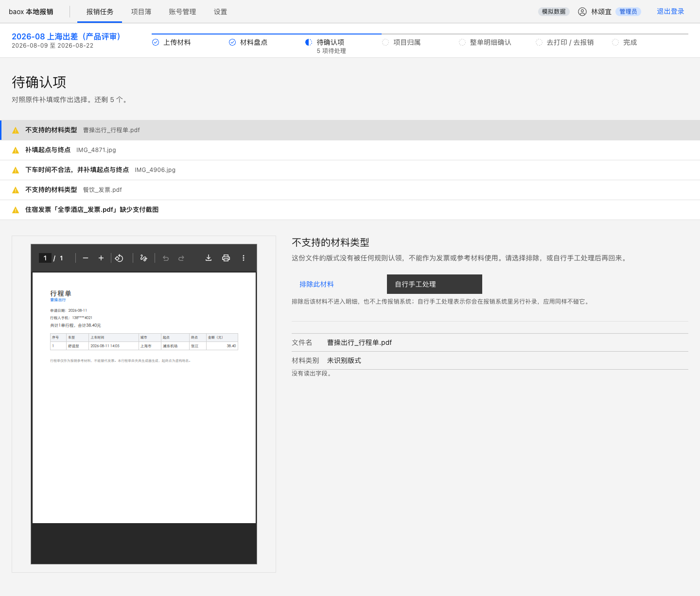
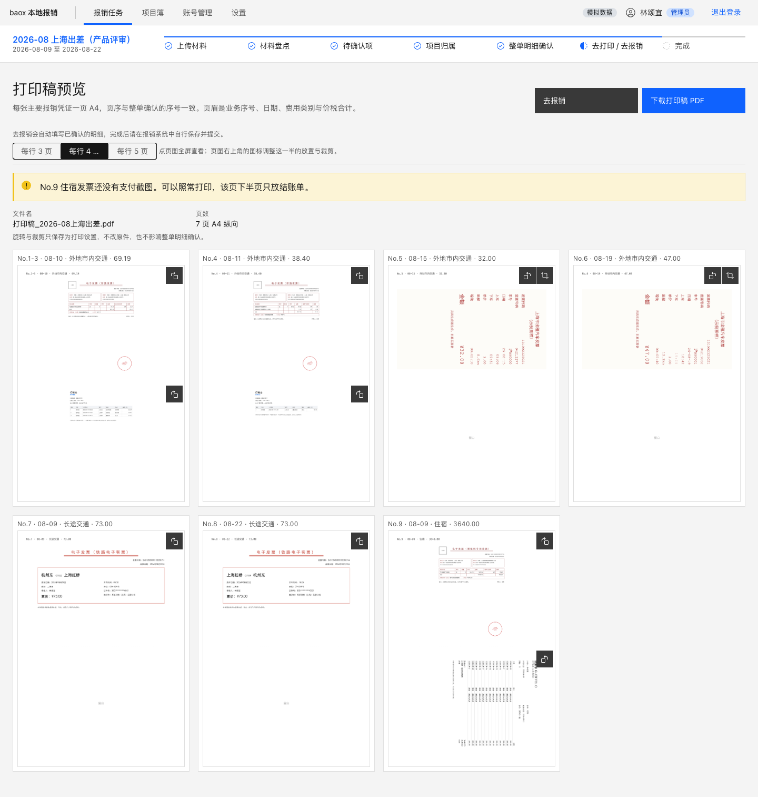
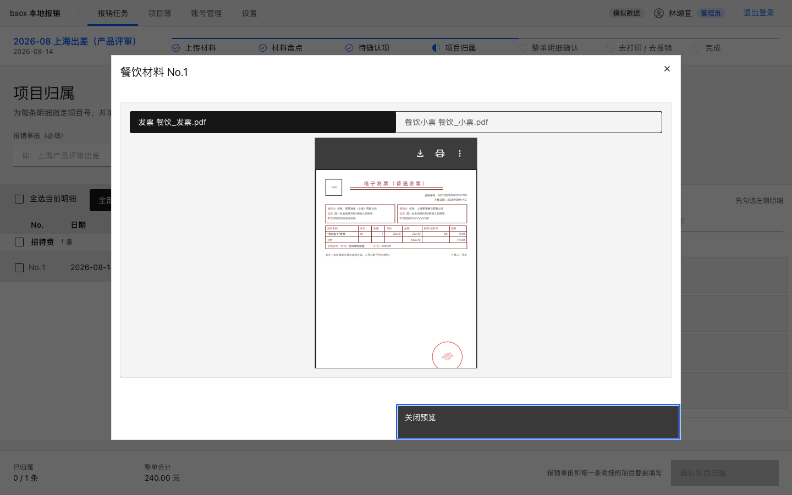
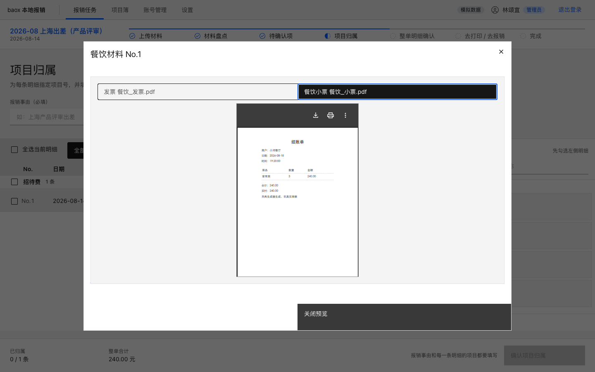
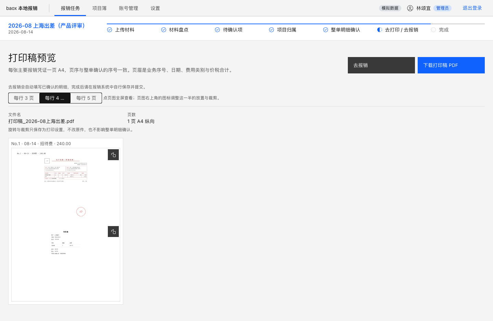
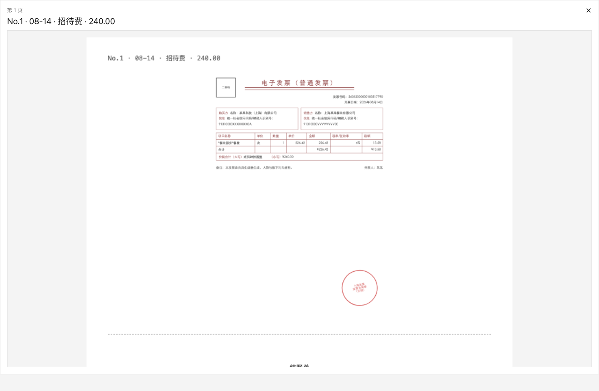

# Dining preview and print evidence

The before images come from `web/scripts/ui-shots.mjs` on main at `094732d561991f95d211a0ccb2429e5ad631a786`, at 1440 × 900.
The pending list includes the dining invoice as unsupported. The default print sheet has no dining page.

The after images use the same script's `06-dining` state. It uploads only `餐饮_发票.pdf` and `餐饮_小票.pdf`, opens their paired preview, switches documents, and confirms the task before printing.
The fixtures are m11 and m13. The category is 招待费, and both amounts are 240.00.

Run these commands from the repository root on the Mac with Google Chrome installed.

```sh
pnpm --filter @baox/web build:mock
node web/scripts/ui-shots.mjs --out /tmp/dining-after --only 06-dining --widths 1440
pnpm test:e2e e2e/server/dining.spec.ts
```

The script creates invoice, receipt, print, and full-screen print images. The server journey independently uploads the originals, verifies reciprocal pairing and the hospitality line, switches the preview, and downloads a one-page PDF with invoice and receipt placements.

The mock print fixtures also cover the discounted PDF and photo receipt. Each has its own composed page image, PDF, and rotation variants. Generate them with the existing fixture generator.

```sh
node fixtures/scripts/generate.mjs dining dining-discounted dining-photo print-dining-r01 print-dining-r10 print-dining-r11 print-dining-discounted-r01 print-dining-discounted-r10 print-dining-discounted-r11 print-dining-photo-r01 print-dining-photo-r10 print-dining-photo-r11
node fixtures/scripts/verify.mjs
```

Before pending items.



Before printing.



After selecting the invoice.



After selecting the receipt.



After printing the paired dining item.



The full-screen print view opens the page at reading size. Scroll down in the viewer to inspect the receipt half.


