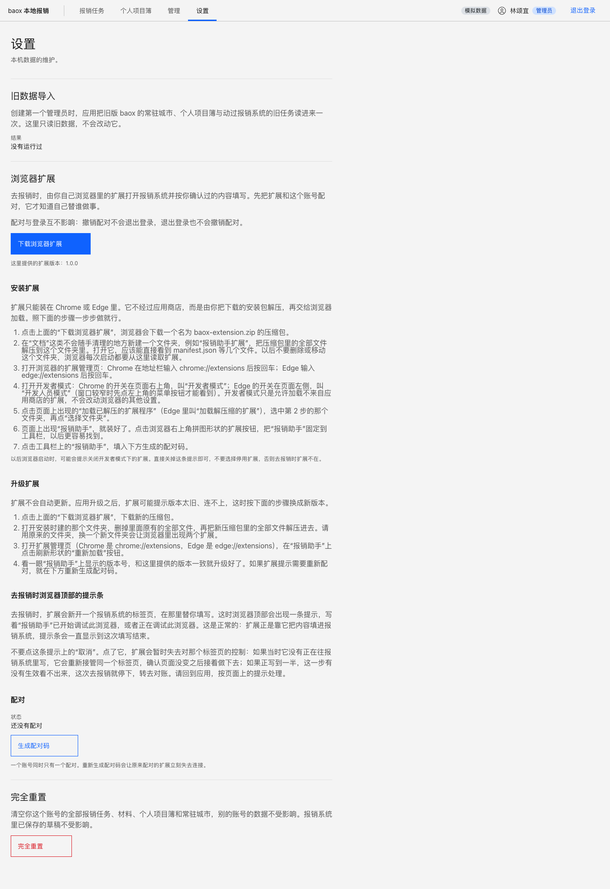
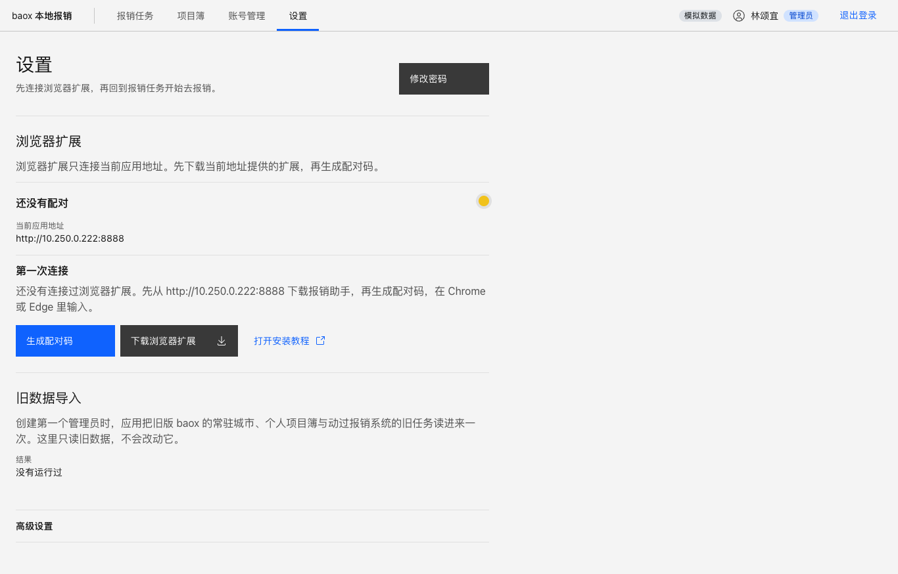
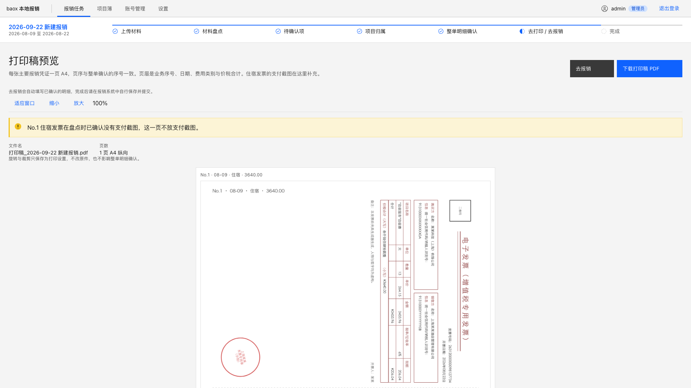
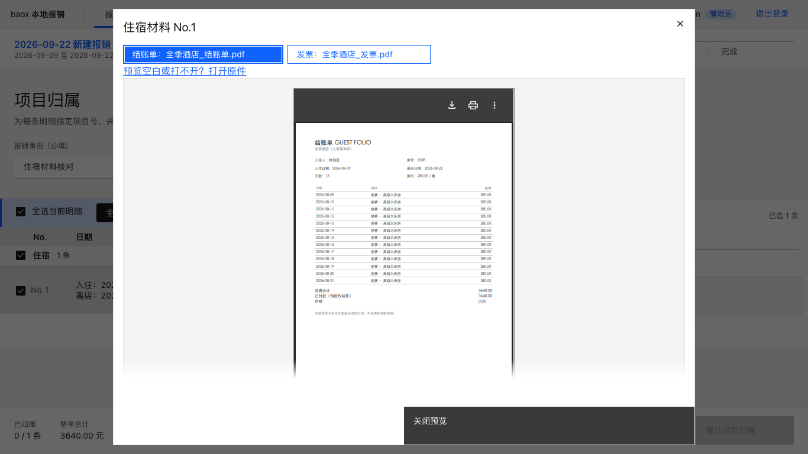

# Novice workflow review evidence

The screenshots use synthetic mock data or isolated browser fixtures. No private invoice corpus or production ERP data appears here.

## Settings

The baseline places installation instructions before pairing and exposes reset as a routine action. The updated page leads with the current extension state and next action, links to a separate illustrated tutorial, and keeps reset in advanced settings.

| Before, 1366 px | After, 1366 px |
| --- | --- |
|  |  |

The screenshots include the full page. Browser tests separately assert that the main extension action is visible without scrolling at 1366 × 768 and 1920 × 1080.

## Print and lodging

The print preview centers the document and provides viewing controls. A lodging preview defaults to a recorded associated bill and retains the invoice as a separate choice. Opening or switching a preview preserves the current project selection and reimbursement purpose.

The [1920 px settings capture](settings-after-1920.png) shows the same extension action at the second acceptance viewport.

## Validation

The implementation at `bdd191b`, merged without conflicts as `4123c50`, passed:

- `pnpm typecheck`.
- Sequential `pnpm test`: 986 tests across the contract (9), ERP executor (109), extension (37), web (240), and server (591).
- The production server/web build and mock build, followed by the complete isolated Playwright suite with one worker: 393 tests.
- `pnpm test:private` with the maintainer's local corpus: all aggregate gates passed.

Standards and Spec reviews ran independently. Four Standards findings and three Spec findings, including one shared finding, were fixed. Both reviewers rechecked their findings with no remaining issue. The final merged source matches the reviewed file hashes.

The installer renderer and shell syntax were checked in isolation. The root-only installer, production migration, and live ERP save/submission were not exercised.
